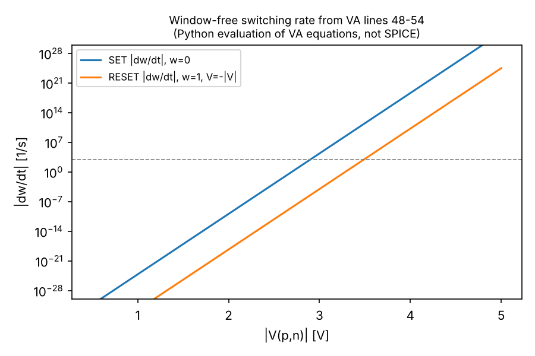
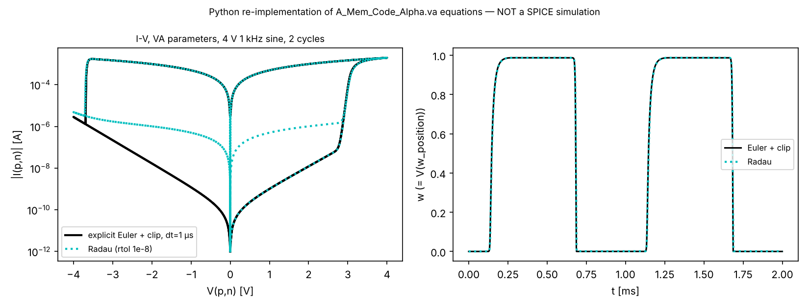
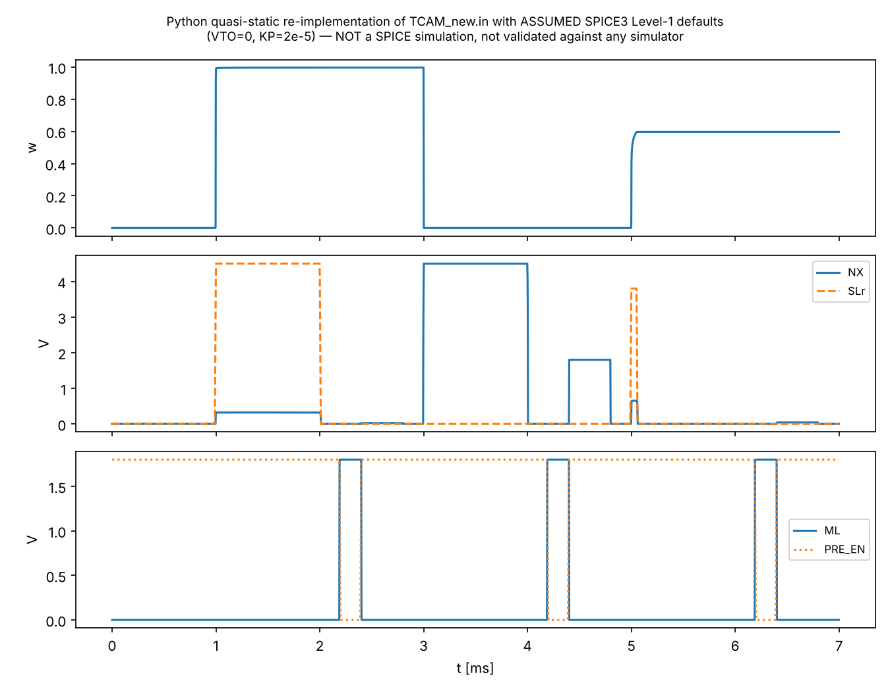

# Verilog-A memristor model and 3T1R TCAM netlist: technical analysis

Scope: `A_Mem_Code_Alpha.va` (Verilog-A compact model) and `TCAM_new.in` (SPICE-format testbench). The Python deterministic model is used only for cross-reference (Section 5). Conventions used throughout:

- **Quoted code** is followed by `file:line`.
- **"Not stated in source"** means the files do not give that information.
- **INFERENCE** marks my own interpretation, with the reasoning given.
- **PYTHON CHECK** marks results from my scratch Python re-implementations. These are *not* SPICE simulations. No circuit simulator was run (none is installed; see Section 4).

---

## 1. Summary

- The Verilog-A module is a **two-terminal memristor with one state variable** $w\in[0,1]$. It also has a third "probe" terminal that outputs $w$ as a voltage.
  - $w$ is stored with `idt()`.
  - The state equation is an Arrhenius rate with linear (in V) barrier lowering, plus polynomial windows $(1-w)^{9}$ for SET and $w^{0.8}$ for RESET.
  - The current law blends a symmetric "Schottky-like" exponential (HRS) with a linear metallic conductance (LRS), weighted by $w$.
- **Thresholds.** `v_off = v_on = 0`, so switching has no hard threshold. The apparent thresholds come from the exponential: for the window-free rate to reach 1/s, the device needs about +2.69 V (SET) or −3.28 V (RESET).
- **Limiting and convergence.**
  - The anti-windup logic reads `w` *before* it is assigned in the same evaluation, so it relies on "hidden state" (lines 66–67 vs 69).
  - Clipping (lines 71–72) changes the output value but not the integrator's internal state.
  - There is no `limexp`, `$limit`, `$bound_step` or `$discontinuity`.
  - The rates are extremely stiff: about $6\times10^{25}\,\mathrm{s^{-1}}$ at +4.5 V.
- **Includes.** The model includes `"constants.h"` and `"discipline.h"`. These are legacy (Spectre-era) header names, not the standard `constants.vams`/`disciplines.vams`. The header comment says "SmartSpice Anti-Windup Engine" (line 62).
- **Testbench.** `TCAM_new.in` is a **single 3T1R cell**: 1 PMOS + 1 NMOS write/read divider, 1 match-line (ML) pull-down NMOS and 1 memristor. Around it are a precharge PMOS and a 1 pF ML capacitor.
  - Sequence: SET write, search, RESET write, search, partial "SET-M" write, search.
  - The search key (SLp/DLp levels) is **the same in all three searches**. No other key and no explicit "don't-care" search is exercised.
- **Transistor models.** These are bare `level=1` cards with **no parameters** (`.model nmos180 nmos level=1`, lines 6–7). There is **no 180 nm PDK**, so the results depend on the simulator's default Level-1 parameters.
  - PYTHON CHECK, assuming SPICE3 defaults (VTO = 0): the ML discharges in **all three** searches, within ns to µs. Only the discharge *speed* differs, not the final ML level.
- **Simulator.** The deck uses SmartSpice-style syntax: `.verilog`, `X`-instantiation of a Verilog-A module, and `.iplot`. A commercial simulator is not strictly required, but porting is.
  - ngspice + OpenVAF needs deck edits **and** a rewrite of the state handling (the hidden-state issue).
  - Xyce/ADMS looks harder (see Section 4; to be verified).
  - A Python port of the single device is trivial and was done here.

## 2. Source files

| File | Lines | Role |
|---|---|---|
| `original_code/A_Mem_Code_Alpha.va` | 94 | Verilog-A memristor module `A_Mem_Code_Alpha(p, n, w_position)` |
| `original_code/TCAM_new.in` | 54 | 3T1R TCAM single-cell testbench |
| `original_code/Luisier_IOP_deterministic.py` | 291 | Python deterministic model, field form `beta*(v/L)` (cross-reference) |
| `Luisier_IOP_deterministic.py` (top level) | — | Variant using `alpha=(beta/(L*q))`, `alpha*(q*v)` (diff verified) |

Header inconsistency: line 2 reads "MoTe2 Phase Change Memristor", but line 17 reads "Device Parameters (Table 2, D11: Ag/WSe2)". Which material and table the parameters come from is not stated unambiguously in the source.

---

## 3. Verilog-A model `A_Mem_Code_Alpha`

### 3.1 Terminals and disciplines

```
module A_Mem_Code_Alpha(p, n, w_position);   // :7
    input p, n;                               // :8
    output w_position;                        // :9
    electrical p, n, w_position;              // :10
```

- **p, n:** the device terminals. The branch is `I(p,n) <+ I_total;` (:93), and the device voltage is `v_val = V(p,n)` (:41). Positive `V(p,n)` gives SET.
- **w_position:** a single-node voltage output, `V(w_position) <+ w;` (:92). This is an ideal voltage source to ground whose value is $w$ (dimensionless, read as volts).
  - In the testbench it is loaded by `r_dummy w1 0 1G` (TCAM:17).
  - INFERENCE: the 1 GΩ load is there so the node has a DC path for simulators that warn about dangling nodes. It is not needed electrically, because the output is a voltage source.
- **`input`/`output` keywords:** have no electrical effect in analog Verilog-A. The branches remain bidirectional.

### 3.2 State variable and storage

| Item | Source | Notes |
|---|---|---|
| $w$ (dimensionless, 0 = HRS / "semiconducting", 1 = LRS / "metallic") | `w = idt(dw_dt * window, w_init);` (:69) | Integrated by the simulator's `idt` operator. The initial condition `w_init = 0.0` (:31) is used in DC/OP and at t = 0. |
| Hidden reuse of $w$ | lines 49, 54, 66, 67 read `w` before :69 assigns it | Uses the value left over from the *previous evaluation* (previous Newton iteration or time-point). Not standard-portable (Section 3.7). |
| Clipped copy | `if (w > 1.0) w = 1.0; if (w < 0.0) w = 0.0;` (:71–72) | Clips only the *variable*. The `idt` internal state is not reset, so the integrator can wind beyond [0, 1]. |

There is no internal node, no `ddt`, no `$bound_step`, no `@(initial_step)` and no `analysis()` test. The state is not a circuit unknown, so the Jacobian contains no $\partial(\dot w)/\partial w$ or $\partial I/\partial w$ coupling. INFERENCE: this follows from the code structure. How `idt` is stamped depends on the simulator.

### 3.3 Governing equations

Let $V\equiv V(p,n)$ (:41) and $k_BT$ = `kB*T` (in eV).

**Switching rate** (:46–59):

$$
\dot w_{\rm raw}=
\begin{cases}
k_{\rm att}\,\exp\!\left[-\dfrac{E_{\rm set}-\alpha\,q\,V}{k_BT}\right]\,|1-w|^{p_{\rm set}}, & V> v_{\rm off}\quad(:48\text{–}49)\\[2ex]
-k_{\rm att}\,\exp\!\left[-\dfrac{E_{\rm reset}-\alpha\,q\,|V|}{k_BT}\right]\,|w|^{p_{\rm reset}}, & V< v_{\rm on}\quad(:53\text{–}54)\\[2ex]
0, & \text{otherwise (dead zone, :58)}
\end{cases}
$$

```
exp_arg = -(Eset - (alpha * q_charge * v_val)) / (kB * T);          // :48
dw_dt = k_attempt * exp(exp_arg) * pow(abs(1.0 - w), p_set);        // :49
exp_arg = -(Ereset - (alpha * q_charge * abs(v_val))) / (kB * T);   // :53
dw_dt = -k_attempt * exp(exp_arg) * pow(abs(w), p_reset);           // :54
```

**Anti-windup gate** (:64–67): $\text{window}=0$ if ($w\ge0.999$ and $\dot w_{\rm raw}>0$) or ($w\le0.001$ and $\dot w_{\rm raw}<0$); otherwise $\text{window}=1$.

**State:** $w(t)=w_{\rm init}+\int_0^t \dot w_{\rm raw}\cdot\text{window}\,dt'$ (:69), then the clip $w\leftarrow\min(\max(w,0),1)$ (:71–72).

**Current** (:77–90), with $n = n_{\rm set}$ if $V\ge0$ and $n = n_{\rm reset}$ otherwise (:77–81):

$$
I_{\rm sch}=\operatorname{sgn}(V)\,I_s\left[\exp\!\left(\frac{|V|}{n\,v_t}\right)-1\right]\quad(:84,\,:86),\qquad
I_{\rm met}=G_{\rm met}\,V\quad(:89)
$$

$$
I(p,n)=(1-w)\,I_{\rm sch}+w\,I_{\rm met}\quad(:90,\,:93)
$$

Notes on the equations:

- $I_{\rm sch}$ is an **odd-symmetric** exponential. It is not a rectifying Schottky diode, because the reverse branch grows exponentially instead of saturating. The source does not say why.
- `vt = 0.026` (:15) is an independent parameter. It is *not* computed from `kB*T` (0.025851 eV at 300 K), so changing `T` changes the switching rates but not the conduction.

### 3.4 Parameter table (values verbatim from source)

| Name | Value | Unit as commented | Line | Class | Remarks |
|---|---|---|---|---|---|
| `kB` | 8.617e-5 | eV/K | 13 | physical constant | |
| `T` | 300.0 | K | 14 | physical (operating condition) | Affects the rate only |
| `vt` | 0.026 | "Thermal voltage" (V, INFERENCE) | 15 | physical/fitting | Not tied to `T` |
| `q_charge` | 1.602e-19 | C | 16 | physical constant | |
| `alpha` | 5.3e18 | "Barrier lowering coefficient", unit not stated | 18 | fitting (field coupling) | See note A below |
| `k_attempt` | 1e12 | Hz | 19 | physical/fitting (attempt frequency) | |
| `v_off` | 0 | "SET threshold" (V) | 21 | numerical/model switch | Zero, so no threshold |
| `v_on` | 0 | "RESET threshold" (V) | 22 | numerical/model switch | Zero |
| `Eset` | 3.0 | eV | 23 | physical/fitting (activation energy) | |
| `Ereset` | 3.5 | eV | 24 | physical/fitting | |
| `Is` | 1.0e-10 | "Schottky Saturation Current", unit not stated (A, INFERENCE) | 26 | fitting | |
| `n_set` | 16 | ideality factor (dimensionless) | 27 | fitting | Used for all $V\ge0$, not only during SET |
| `n_reset` | 15.0 | ideality factor | 28 | fitting | Used for all $V<0$ |
| `G_metallic` | 0.05e-2 = 5e-4 | "Metallic conductance", unit not stated (S, INFERENCE; 2 kΩ) | 29 | fitting | Python names this `G0`, "DP1 conductance" |
| `w_init` | 0.0 | dimensionless | 31 | initial condition | |
| `p_set` | 9.0 | "Polynomial window for SET" | 32 | fitting/numerical (window shape) | |
| `p_reset` | 0.8 | not commented | 33 | fitting/numerical | <1, so the window is non-Lipschitz at $w=0$ |
| 0.999 / 0.001 | hard-coded | — | 66–67 | numerical (anti-windup bounds) | Not parameters |

**Note A (units of `alpha`, INFERENCE by dimensional analysis):**

- The exponent requires `alpha*q_charge*v_val` to be in eV, because it is added to `Eset` in eV. So `alpha*q` = 0.849 must be in eV/V, and `alpha` has units of eV·V⁻¹·C⁻¹. Numerically, $\alpha q\approx 0.849$ eV/V, which means 84.9 % of the applied voltage lowers the barrier (in eV).
- `alpha = 5.3e18` matches $\beta/(L q)$ with $\beta$ = 0.6e-9 eV·m/V and $L$ = 0.7e-9 m from the Python variant. That gives 5.357e18 with q = 1.6e-19 and 5.350e18 with q = 1.602e-19. The VA value is 1 % lower: rounded, or deliberately set. Not stated in source.
- The combination is physically a dimensionless fraction times $e$. Its physical meaning is not stated in source.

### 3.5 SET/RESET behaviour and effective thresholds

- **SET** for $V>0$ drives $w\to1$; **RESET** for $V<0$ drives $w\to0$. The dead zone is only the single point $V=0$.
- **Asymmetry.** The rates differ in both energy ($E_{\rm reset}-E_{\rm set}$ = 0.5 eV) and window: $(1-w)^9$ makes the approach to $w=1$ very slow, while $w^{0.8}$ reaches $w=0$ in finite time.
- **Effective thresholds.** Solving the window-free rate $k_{\rm att}e^{-(E-\alpha qV)/k_BT}=R$ for $V$ (PYTHON CHECK, exact arithmetic on VA values):

| Target rate R | SET voltage | RESET voltage |
|---|---|---|
| 1 s⁻¹ | +2.692 V | −3.281 V |
| 1e3 s⁻¹ | +2.902 V | −3.491 V |
| 1e6 s⁻¹ | +3.113 V | −3.702 V |
| 1e9 s⁻¹ | +3.323 V | −3.912 V |

- **Rates at the testbench voltages:**
  - SET: +3.8 V gives 6.4e15 s⁻¹, +4.5 V gives 6.2e25 s⁻¹.
  - RESET: −4.5 V gives 2.4e17 s⁻¹.
  - Read disturb at |V| = 1.8 V (worst-case search condition) is negligible: 1.9e-13 s⁻¹ (SET), 7.5e-22 s⁻¹ (RESET).
- **No current compliance in the model.** Compliance in the TCAM comes only from the access transistors (Section 4.4).



### 3.6 Single-device I–V (PYTHON CHECK)

Stimulus: 4 V, 1 kHz sine, 2 cycles (same waveform shape as the Python script). The VA equations were integrated two ways: explicit Euler with clipping at dt = 1 µs (Python-script style), and stiff Radau (rtol 1e-8) honouring the 0.001/0.999 gates.



Observations (Python re-implementation of the VA equations, not a SPICE simulation):

1. Under SET, $w$ saturates at about **0.987**, not 1. The $(1-w)^9$ window makes $\dot w$ collapse, so the 0.999 gate is never reached at 4 V / 1 kHz. Euler and Radau agree.
2. Under RESET, Radau (and any accurate integrator honouring the gate) stops at **$w\approx0.001$**, while Euler + clip goes to exactly 0. Because $w\,G_{\rm met}\,V$ with $w$ = 0.001 (about 2 MΩ) dominates $I_{\rm sch}$ at low bias, **the HRS read current in a SPICE run is set by the hard-coded 0.001 gate**. This gives an HRS current about 10–100× higher than Euler+clip below about 2.5 V.

   This numerical parameter therefore directly affects the HRS on/off ratio, and hence the TCAM sensing margin.

### 3.7 Convergence, limiting and simulator-specific constructs

| Construct | Line | Assessment |
|---|---|---|
| `` `include "constants.h"``, `` `include "discipline.h"`` | 4–5 | Legacy (Cadence Spectre-style) names. Standard VA-LRM names are `constants.vams`, `disciplines.vams`. OpenVAF bundles only the `.vams` names (INFERENCE from OpenVAF documentation, not tested here), so these lines would need editing. No constant from `constants.h` is actually used. |
| `idt(x, ic)` | 69 | Standard VAMS. Supported by Spectre-class simulators. OpenVAF compiles `idt` (to be verified for the installed version). Xyce/ADMS support for `idt` is doubtful (to be verified). |
| Reading `w` before assignment | 49, 54, 66, 67 | **Hidden state.** Correct behaviour relies on variables keeping their value between evaluations. OpenVAF and Xyce's ADMS flow assume variables carry no hidden state (they are re-initialised, effectively 0). INFERENCE, to be verified. If $w$ is read as 0, the RESET gate `w <= 0.001 && dw_dt<0` is always true, so **RESET would never occur**, and the $(1-w)^9$ window would always equal 1. This is the most important portability defect. |
| Hard `if` gates and clipping | 66–67, 71–72 | Non-smooth; derivatives are discontinuous. The integrator can overshoot: the clip hides the overshoot in the output but the `idt` state keeps it, so RESET must first "unwind" the excess. |
| `exp()` without `limexp` | 49, 54, 84, 86 | Overflow (arg > 709) only for \|V\| > 25 V in the rate. The real risk is Newton iterates with large V, together with the extreme stiffness of the rates. |
| `pow(abs(w), 0.8)` | 54 | Infinite derivative at $w=0$. |
| `$bound_step`, `$limit`, `$discontinuity`, `@(initial_step)` | — | Absent. Without `$bound_step`, timestep control relies on the simulator's LTE estimate for `idt`. |
| Comment "SmartSpice Anti-Windup Engine" | 62 | Suggests SmartSpice (Silvaco) was the target. The simulator version is not stated. |

**Recommended portable reformulation (INFERENCE, not author code).** Make $w$ a circuit unknown on an internal node:

```
I(xw) <+ ddt(V(xw)) - f(V(p,n), V(xw))
```

- Compute the rate from `V(xw)`, and use smooth windows or `min/max` on the rate instead of a hidden-state gate.
- Optionally add `$bound_step`.
- Drive `V(w_position) <+ V(xw)`.

This gives a correct Jacobian and works in OpenVAF and ADMS-style flows. It would also change the numerical behaviour near the bounds, so it must be re-validated against the author's SmartSpice results.

---

## 4. TCAM circuit `TCAM_new.in`

### 4.1 Architecture

```
.subckt TCAM_3T1R ML SLp DLp SLr DLn SLn                 :12
MP1 NX DLp SLp SLp pmos180 L=180n W=10u                   :13  (D G S B)
MN1 NX DLn SLn SLn nmos180 L=180n W=10u                   :14
MNML ML NX 0 0 nmos180 L=180n W=20u                       :15
XR1 SLr NX w1 A_Mem_Code_Alpha                            :16  (p=SLr, n=NX)
r_dummy w1 0 1G                                           :17
```

The cell is 3 transistors and 1 memristor ("3T1R", :1). Lines:

- **ML:** match line.
- **SLp, DLp:** source and gate of the PMOS.
- **SLn, DLn:** source and gate of the NMOS.
- **SLr:** memristor top terminal.

There is no word line separate from these, and no array. The testbench instantiates **one** cell (`X_TCAM_1`, :22).

```
                 VDD(1.8V)
                   |
         PRE_EN --|| M_PRE (pmos 10u/180n, bulk VDD)
                   |
   ML o------------+-----------------+---- C_ML 1pF -- GND
                                     |
                               MNML (nmos 20u/180n)
                          gate=NX -->|      source/bulk = GND
                                     |
                                    GND
   SLr o----[ memristor XR1 ]----o NX o------------------+
            p             n      |   (gate of MNML)     |
                    w_position=w1 |                      |
                     |         MP1 (pmos 10u)          MN1 (nmos 10u)
                  r_dummy 1G   gate=DLp                gate=DLn
                     |         source=bulk=SLp         source=bulk=SLn (=0 V DC)
                    GND
```

Node NX is the output of a divider: the memristor (from SLr) against MP1 (from SLp) and MN1 (to SLn). NX drives the gate of the ML pull-down.

### 4.2 Device models

- `.verilog "A_Mem_Code_Alpha.va"` (:5) loads the Verilog-A file. This is SmartSpice-style syntax.
- `.model nmos180 nmos level=1` and `.model pmos180 pmos level=1` (:6–7) have **no parameters**. No PDK or foundry model card is included or referenced. The names "180" refer only to L = 180n in the instances.
- Every transistor parameter (VTO, KP, LAMBDA, GAMMA, TOX, junction IS/CJ, overlap caps) therefore takes **simulator defaults**. INFERENCE: SPICE3/ngspice Level-1 defaults are VTO = 0, KP = 2e-5 A/V², LAMBDA = 0, GAMMA = 0, junction IS = 1e-14 A and no capacitances. SmartSpice defaults are not stated in source and not verified.
- VTO = 0 for both device types would make MOSFETs conduct for any positive overdrive. That strongly affects the search behaviour (Section 4.5).
- Voltages of 4.5–6 V on 180 nm-sized devices would exceed a real 1.8 V process. INFERENCE: this is irrelevant for Level-1 but means the deck is not process-realistic.

### 4.3 Sources and stimulus

| Source | Node | Waveform (verbatim breakpoints) | Line |
|---|---|---|---|
| `V_VDD` | VDD | DC 1.8 | 24 |
| `V_SLn` | SLn | DC 0 | 25 |
| `C_ML` | ML | 1 pF to ground | 30 |
| `M_PRE` | ML ← VDD, gate PRE_EN | pmos180 10u/180n | 32 |
| `V_PRE_EN` | PRE_EN | 1.8 V, except 0 V during 2.2–2.39, 4.2–4.39 and 6.2–6.39 ms (10 µs edges) | 34 |
| `V_DLn` | DLn | 6 V during 1–2 ms; 0.25 V during 5–5.05 ms; else 0 | 39 |
| `V_SLr` | SLr | 4.5 V during 1–2 ms; 3.8 V during 5–5.05 ms; else 0 | 41 |
| `V_SLp` | SLp | 1.8 V during 2.2–2.9, 4.2–4.9 and 6.2–6.9 ms; 4.5 V during 3–4 ms; else 0 | 43 |
| `V_DLp` | DLp | 4.5 V (off); 1.65 V during 2.4–2.8, 4.4–4.8 and 6.4–6.8 ms ("Goldilocks Choke"); 0 V during 3–4 ms | 45 |

### 4.4 Operation sequence (from the stimulus; the electrical reading is INFERENCE)

| Phase | Time (ms) | Biases | Intended action (source comments) | Electrical reading (INFERENCE) |
|---|---|---|---|---|
| Idle | 0–1 | all 0, DLp = 4.5 | — | $w = w_{\rm init} = 0$ (HRS). ML is floating at 0 V, because M_PRE has Vsg = 0 and MNML is off. |
| W1 SET | 1–2 | SLr = 4.5, DLn = 6 | "Full write for SET" (:38) | MN1 holds NX near 0 V, so $V(p,n)\approx+4.2$ V and the device SETs. MN1 acts as a ~150 Ω switch (Level-1 defaults). |
| Precharge 1 | 2.2–2.39 | PRE_EN = 0, SLp = 1.8 | "PRE_EN Pulses to 0V (ON) right before each Search Phase" (:33) | ML charges to 1.8 V. |
| Search 1 | 2.4–2.8 | SLp = 1.8, DLp = 1.65, SLr = 0, DLn = 0 | "1.8V during Searches" (:42) | MP1 is a weak current source (Vsg = 0.15 V). LRS pulls NX low; HRS lets NX rise to about SLp, which turns MNML on. |
| W2 RESET | 3–4 | SLp = 4.5, DLp = 0, SLr = 0 | "4.5V for RESET" (:42) | MP1 on pulls NX to about 4.5 V, so $V(p,n)\approx-4$ V and the device RESETs. |
| Precharge / Search 2 | 4.2–4.39 / 4.4–4.8 | as Search 1 | — | HRS: NX ≈ 1.8 V, so ML discharges fast (mismatch). |
| W3 "SET-M" | 5–5.05 | SLr = 3.8, DLn = 0.25 | "gentle 0.25V pulse for SET-M" (:38) | MN1 in saturation limits the current to about 35 µA (Level-1 defaults). This acts as a transistor-based current compliance, giving a *partial* SET. INFERENCE: "M" means a "middle"/intermediate state. Not stated in source. |
| Precharge / Search 3 | 6.2–6.39 / 6.4–6.8 | as Search 1 | — | Intermediate $w$ gives an intermediate NX. |

**Match / mismatch / don't-care.** How the ternary encoding works is **not stated in source**. With one memristor and a single, fixed search bias, the deck only demonstrates that the **stored state (LRS / HRS / intermediate) controls the ML discharge** under one search condition. A plausible but unconfirmed reading (INFERENCE):

- LRS → NX low → MNML off → ML stays high = "match".
- HRS → NX high → ML discharges = "mismatch".
- The intermediate SET-M state might be meant as a third (possibly "X") level.

The deck never changes the search key (e.g. SLp/DLp search-0 vs search-1 levels), so a ternary truth table cannot be derived from this file. A "don't-care" search (masking the key) is not present.

### 4.5 PYTHON CHECK: quasi-static deck re-implementation (assumed Level-1 defaults)

Because no device capacitances are specified, node NX has no capacitance, and the ML is decoupled from NX (it connects only through the gate of MNML). The deck can therefore be re-implemented as follows:

- NX is solved algebraically from KCL at each instant: memristor + MP1 + MN1 + MOSFET drain–bulk junctions (IS = 1e-14 A).
- $w$ is integrated with the VA rate and gates.
- ML is integrated as `C_ML dV/dt = I(M_PRE) − I(MNML)`.

Script: `/tmp/claude-0/-home-claude/7b3d0c97-9349-5b14-a515-ca80f50bbf65/scratchpad/agent2/tcam_port.py`.

**This is a Python re-implementation under ASSUMED SPICE3 Level-1 defaults (VTO = 0, KP = 2e-5). It is not a SPICE simulation and has not been validated against any simulator.** The integrator for $w$ is explicit with clipping, so it lands at exactly 0 after RESET, whereas a SPICE run stops at about 0.001 (Section 3.6).



| Instant | w | NX (V) | ML |
|---|---|---|---|
| end of SET write (2.0 ms) | 0.9959 | 0.32 | — |
| Search 1 (2.45 ms) | 0.9959 | 0.025 | discharged to 0 within ~3 µs |
| end of RESET write (4.0 ms) | 0.000 | 4.05 | — |
| Search 2 (4.45 ms) | 0.000 | 1.80 | discharged within ~1 ns |
| after SET-M (5.05 ms) | 0.597 | 0.65 | — |
| Search 3 (6.45 ms) | 0.597 | 0.042 | discharged within ~µs |

Static search operating point vs $w$, and the MNML saturation current at ML = 1.8 V:

| w | NX (V) | I(MNML) (A) | rough ML discharge time C·1.8 V / I |
|---|---|---|---|
| 0 | 1.800 | 3.6e-3 | 0.5 ns |
| 0.001 | 1.795 | 3.6e-3 | 0.5 ns |
| 0.01 | 1.733 | 3.3e-3 | 0.5 ns |
| 0.1 | 0.250 | 6.9e-5 | 26 ns |
| 0.5 | 0.050 | 2.8e-6 | 0.65 µs |
| 1 | 0.025 | 6.9e-7 | 2.6 µs |

Interpretation (INFERENCE):

- With VTO = 0, the 400 µs evaluation window is far longer than every discharge time, so **ML ends near 0 V in all three searches**. Match and mismatch differ only in discharge *speed*, by about 10³–10⁴×. A timed sense amplifier would be needed, and none is in the deck.
- The author's simulator may use different Level-1 defaults (e.g. a non-zero VTO), and that would change this conclusion. The author's own output waveforms are needed to settle it.
- **SET-M clamp.** During SET-M, NX rises to about 0.65 V, where the MP1 drain–bulk junction (bulk = SLp = 0 V) becomes forward-biased. It clamps NX alongside MN1.

### 4.6 Analyses and outputs

- `.options itl4=100 reltol=0.005` (:8): the transient iteration limit is raised, and reltol is loosened 5× from the 1e-3 default. Both are standard SPICE options. INFERENCE: they were added to help convergence of the stiff memristor.
- `.tran 0.01m 7m 0` (:49): tstep = 10 µs, tstop = 7 ms, tstart = 0. There is no `tmax` and no `UIC`. DC operating point first: ML is a floating node (gmin only) and `idt` returns `w_init` in DC.
- `.save` (:50), `.plot tran` (:51), `.print tran` (:52): V(DLp), V(X_TCAM_1.nx), V(ML), V(X_TCAM_1.w1) (= $w$), V(SLr), and V(SLr, X_TCAM_1.nx) (= memristor voltage). Hierarchical names use `X_TCAM_1.` prefixes.
- `.iplot tran …` (:53): an interactive plot. SmartSpice-specific; not an ngspice/Xyce dot-command.
- There are **no `.meas` statements**, so there is no automated match/mismatch metric. Branch currents, e.g. the memristor current, are not saved.

---

## 5. Simulator dependencies and open-source portability

**Tool availability in this container.** `which openvaf ngspice Xyce xyce admsXml iverilog` returned nothing, and no `*.vams` headers or PySpice package exist. **No circuit simulation was tested.**

| Route | Feasibility | Required changes / blockers |
|---|---|---|
| **SmartSpice (Silvaco)** | Original target (comment :62, `.verilog`, `.iplot`) | Commercial; not assumed available. Version not stated. |
| **ngspice + OpenVAF (OSDI)** | Feasible with edits | (1) Headers → `constants.vams`/`disciplines.vams`. (2) **Remove hidden state** (Section 3.7 reformulation), otherwise RESET is likely suppressed. (3) Compile with `openvaf A_Mem_Code_Alpha.va` → `.osdi`. (4) In the deck, replace `.verilog …` with `.control` / `pre_osdi A_Mem_Code_Alpha.osdi` / `.endc`. (5) Add `.model memr A_Mem_Code_Alpha` and change `XR1 SLr NX w1 A_Mem_Code_Alpha` to `NR1 SLr NX w1 memr` (OSDI instances use the `N` prefix). (6) Delete `.iplot`. (7) Optionally replace `.plot`/`.print` with a `.control` block and `wrdata`, and add a `tmax`, e.g. `.tran 1u 7m 0 1u`. (8) `X_TCAM_1.nx` → `x_tcam_1.nx` (case-insensitive; normally fine). (9) Decide and document Level-1 parameters explicitly instead of relying on defaults. |
| **Xyce (ADMS / buildxyceplugin)** | Uncertain | ADMS flow requires the Xyce/ADMS-compatible VA subset. `idt()` and hidden state are believed unsupported (to be verified). Use the internal-node `ddt` reformulation; `.verilog` → plugin load (`-plugin`); `.iplot` removed; instance syntax per the Xyce plugin (`YA_Mem_Code_Alpha` or a model card, per the Xyce docs). |
| **Pure Python** | Single device: trivial (done, Section 3.6). The single-cell deck is feasible quasi-statically only because NX has no capacitance (Section 4.5). | This is a *re-implementation*, not the author's simulation. It needs explicit MOSFET parameters and does not replace a validated SPICE run, especially with a real PDK. |

---

## 6. Consistency with the Python deterministic model

Python references: `original_code/Luisier_IOP_deterministic.py` (O) and the top-level variant (V).

| Quantity | Verilog-A | Python | Match? |
|---|---|---|---|
| Rate form | $k e^{-(E-\alpha qV)/k_BT}$ (:48, :53) | O: `exp(-(Eset - beta*(v/L))/(k_B*T))` (O:71); V: `alpha*(q*v)` with `alpha=beta/(L*q)` (V diff) | Same functional form. V is algebraically identical to O. |
| Coupling | `alpha=5.3e18`, $\alpha q$ = 0.849 eV/V | `beta=0.6e-9`, `L=0.7e-9` → β/L = 0.857 eV/V (α = 5.357e18); `beta_fp=0.56e-9` → 0.80 eV/V (α_fp = 5.0e18) | VA ≈ **empirical** β (−1 %), *not* β_fp |
| Eset / Ereset | 3.0 / 3.5 eV | empirical `Eset=3.1`, `Ereset=3.7`; "fp" (labelled "Ab inito Model", O:265) `Eset_fp=3.0`, `Ereset_fp=3.5` | VA energies = **fp** set |
| k_attempt | 1e12 Hz | 6e12 Hz (O:22) | **Mismatch** |
| v_off / v_on | 0 / 0 | 0 / 0 (O:50–51) | Match |
| p_set / p_reset | 9 / 0.8 | 9 / 0.8 (O:61–62) | Match |
| Window | `pow(abs(1-w),p_set)`, `pow(abs(w),p_reset)` | `(1-w)**p_set`, `-(w)**p_reset` | Match (VA adds `abs`) |
| Anti-windup | 0.999 / 0.001 gates + clip | none; `np.clip(w+dw,0,1)` (O:108) | **Different**. Changes HRS (Section 3.6). |
| Integration | simulator `idt` (implicit, adaptive) | explicit Euler, dt ≈ 1 µs (O:40, 45, 99, 108) | Different scheme |
| Is | 1.0e-10 | 5.0e-9 (O:25) | **Mismatch** (×50) |
| n_set / n_reset | 16 / 15 | 16.280 / 15 (O:26–27) | n_set slightly different |
| vt | 0.026 | 0.026 (O:28) | Match |
| G_metallic | 5e-4 | `G0=0.05e-2`, `N_channels=1` (O:15, 31–32) | Match |
| I_sch | sign-split exp (:84, :86) | `Is*(exp(|v|/(n*vt))-1)*sign(v)` (O:126) | Equivalent |
| I_total | $(1-w)I_{sch}+wI_{met}$ | same (O:130) | Match |
| Current floor | none | `np.maximum(abs(I),1e-11)` (O:131), plotting only | Python-only display clamp |
| kB, T | 8.617e-5, 300 | 8.617e-5, 300 | Match |
| q | 1.602e-19 | V: 1.6e-19 | Minor (0.1 %) |
| Stochastic terms | none | `sigma`, `U0`, `dU_dw` present but unused in deterministic update (O:63–66, 101–106) | N/A |

**Conclusion.** The VA model is a **hybrid parameter set**: fp energies, empirical-β coupling (rounded), a different attempt frequency and a different Is. The source does not say whether this is intentional (e.g. refitted for the TCAM) or accidental. The VA model therefore does not reproduce either Python curve exactly.

---

## 7. Website: what can be shown vs what needs an external simulator

| Item | Status | Condition |
|---|---|---|
| Parameter table, equations and code excerpts with line numbers | **Demonstrable** | Static content from the source |
| Single-device I–V, w(t) and rate-vs-V, computed in-browser or in Python from the VA equations | **Demonstrable**, labelled "re-implementation of the Verilog-A equations, not a SPICE simulation" | Must state the integration method and how the 0.001/0.999 gates are treated |
| Interactive parameter sliders (Eset, alpha, p_set, …) on the single device | Demonstrable | Same label |
| 3T1R schematic and phase-by-phase operation description or animation | **Demonstrable as an illustration** | Must be labelled as an explanatory illustration, not a simulation result |
| TCAM truth table (match / mismatch / don't-care) | **Only partially supported by source** | The deck exercises one search key. A ternary truth table would need the author's encoding. Do not invent one. |
| Quasi-static Python TCAM waveforms (Section 4.5) | Possible only with heavy caveats | Under assumed Level-1 defaults; not equivalent to the author's simulation. INFERENCE: better left out unless the author approves the parameters. |
| Transistor-level TCAM transients as the author obtained them | **Requires an external simulator** (SmartSpice, or ngspice + OpenVAF after porting) | Or static plots of simulator outputs **supplied by the user** |
| Any result with a real 180 nm PDK | **External simulator + PDK required** | No PDK in source |

---

## 8. Issues and uncertainties

1. **Hidden state** (VA :49, :54, :66–67 read `w` before :69). Simulator-dependent and likely broken in OpenVAF/ADMS.
2. **Integrator windup.** The clip at :71–72 does not reset the `idt` state.
3. **HRS set by a numerical constant.** The 0.001 gate (:67) sets the residual LRS fraction and dominates the HRS read current.
4. **SET rarely completes.** The $(1-w)^9$ window prevents reaching 0.999. $w$ saturates at about 0.987–0.996, depending on bias and duration (PYTHON CHECK).
5. **Extreme stiffness.** Rates up to about 1e25 s⁻¹; no `limexp` or `$bound_step`. The results may depend on simulator tolerances (`reltol=0.005`).
6. **Units not stated** for `alpha`, `Is`, `G_metallic` and `vt`. `vt` is decoupled from `T`.
7. **Material label conflict:** MoTe2 (:2) vs Ag/WSe2, Table 2, D11 (:17). The referenced paper/table is not identified.
8. **Parameter mix** vs Python: fp energies, empirical β, k = 1e12 vs 6e12, Is = 1e-10 vs 5e-9, n_set 16 vs 16.28.
9. **MOSFET models are bare Level-1 defaults.** Results depend on the simulator; under SPICE3 defaults (VTO = 0) the ML discharges in all searches.
10. **Ternary encoding and don't-care not defined** in the deck. A single search key is used. The meaning of "SET-M" and "Goldilocks Choke" (1.65 V) is not explained beyond the comments.
11. **Odd-symmetric "Schottky" law** (no reverse saturation). The physical justification is not stated.
12. **Simulator and version not stated.** SmartSpice is implied only by the comment (:62) and the syntax.
13. **Header names** `constants.h`/`discipline.h` are non-standard for open-source tools.
14. **Not tested.** No simulator is available in this environment, so no SPICE run was performed. All numerical statements are either Python re-implementations or hand analysis.
